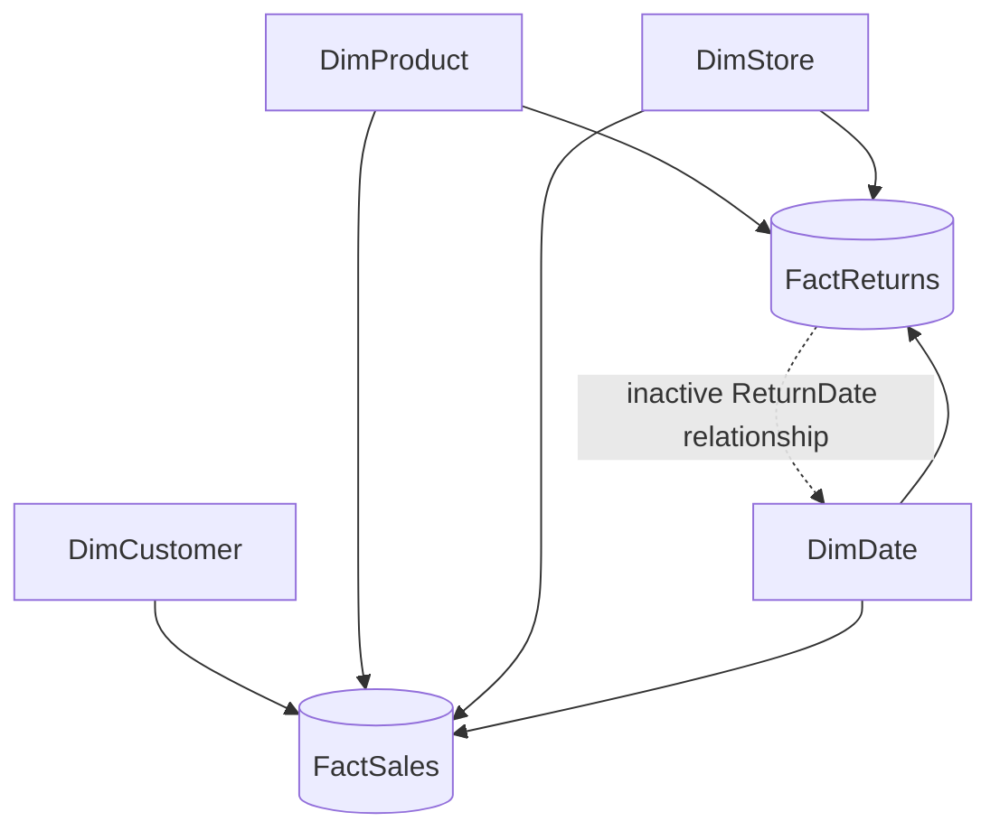

# RetailPulse | European Retail Performance & Profitability Analytics

**End-to-end Power BI portfolio project** | Power Query · DAX · Star Schema · Business Analysis · Row-Level Security · Power BI Service

> **Portfolio disclosure:** RetailPulse is an independent learning and portfolio project built using **entirely synthetic retail data** for a fictional retailer. It is not a client engagement. The analysis covers France, Germany, Italy and Spain. Primary comparable period: **January–October 2026**, with the same months in 2025 used for year-over-year comparisons.

## Executive summary

Revenue growth does not always translate into stronger profitability. RetailPulse turns order-line transactions, product/store/customer master data and returns into an interactive decision-support report. It examines **growth, margins, product mix and returns**, and proposes areas for management investigation.

### Final validated KPI snapshot

*All four markets combined, Jan–Oct 2026; values from the cleaned Power BI financial QA table (16 Nov 2026). Monetary amounts in EUR.*

| KPI | Value | Definition |
|---|---:|---|
| Sales revenue before refunds | **€975,771.81** | `Total Revenue = SUM(FactSales[NetRevenue])`; net of sales discounts, **not** net of returns |
| Units sold | **13,089** | `SUM(FactSales[Quantity])` |
| Refunds | **€69,404.42** | Returns attributed to the original **order date** |
| Refund-adjusted revenue | **€906,367.39** | Sales revenue minus refunds |
| Gross profit before refunds | **€288,195.50** | Sales revenue minus eligible sales COGS |
| Return-adjusted profit | **€268,206.01** | Report's return-adjusted gross profit, not net accounting profit |
| Gross margin before refunds | **29.5%** | Gross profit before refunds / sales revenue before refunds |
| Unit return rate | **6.71%** | Returned units / sold units, attributed to original order date |

### Market snapshot

| Market | Revenue before refunds | Units sold | Refunds | Refund-adjusted revenue | Gross profit before refunds | Return-adjusted profit | Unit return rate |
|---|---:|---:|---:|---:|---:|---:|---:|
| France | €387,375.07 | 5,196 | €28,752.82 | €358,622.25 | €116,165.09 | €107,650.73 | 6.95% |
| Germany | €299,935.67 | 4,002 | €18,737.08 | €281,198.59 | €88,355.56 | €83,097.26 | 5.72% |
| Italy | €120,437.48 | 1,615 | €7,257.90 | €113,179.58 | €35,397.21 | €33,364.80 | 5.88% |
| Spain | €168,023.58 | 2,276 | €14,656.62 | €153,366.96 | €48,277.63 | €44,093.21 | 8.48% |

> Totals can differ from the sum of displayed market values by €0.01 due to rounding.

## Business questions

1. Are markets growing **profitably**, not just growing revenue?
2. How are **cost per unit, discounts and product mix** changing?
3. Which markets, product categories and return reasons deserve operational attention?
4. How can management explore each market and product category interactively?

## Business findings and recommended investigations

**1 · France — growth accompanied by margin compression.** Jan–Oct 2026 revenue grew approximately **11.1% YoY**, but gross margin contracted by approximately **5.06 percentage points**. Unit growth was approximately **14.2%** in the refreshed cloud report. **Next step:** examine pricing, promotional efficiency, procurement costs and product mix before scaling discounts. *The dashboard is observational; this does not establish causality.*

**2 · Returns — Spain's observed rate is elevated.** Spain registered an **8.48%** observed unit return rate compared with **6.71%** across all four markets. In France, **Consumer Tech** registered approximately **11.35%**, the highest category return rate in the displayed France analysis. **Next step:** investigate product-level returns, product descriptions, fulfillment quality and service issues, controlling for differences in cohort age.

**3 · Profitability pressure across categories.** In the Spain margin view, each of the four major categories showed lower gross margins than in 2025. The displayed cost-per-unit change was approximately **+7.7% YoY**, with discounts up approximately **2.26 percentage points**. **Next step:** quantify cost, price and mix impacts before claiming a specific driver of margin contraction.

*Note: market-specific YoY and category findings above were recorded from report screenshots during the final validation process; rerun the selected-market checks before publishing refreshed screenshots, as minor values may change after deduplication.*

## Data and preparation

| Source | Role |
|---|---|
| 22 monthly sales CSVs (`2025-01` through `2026-10`) | Order-line sales fact table (`FactSales`) |
| `returns.csv` | Return records (`FactReturns`) |
| `master_data.xlsx` | Products, customers, stores dimension tables |
| `sales_targets.xlsx` | Available in starter kit; target-attainment dashboard **not implemented** in final report |
| `campaigns.json` | Available in starter kit; campaign analysis **not implemented** |

**Power Query process:** combine monthly CSVs; normalize market/channel labels; identify and remove **5 duplicate sales `LineID` records** (21,105 original rows → **21,100 distinct sales lines**); retain **22 rows containing missing sale prices** (using null rather than deleting the rows); address duplicated customer master records; validate return-to-sale references and date consistency.

**Data-quality note:** The source has intentionally imperfect fields. The main cost measure excludes sales records with missing `UnitPriceEUR` from cost calculations. `Units Sold` still includes these lines. Thus revenue, COGS and sold units do **not** necessarily share identical eligibility rules. See `docs/METRIC_DEFINITIONS.md`.

## Data model

A star-schema-style import model using shared dimensions and distinct sales/returns fact tables. Relationship filtering is designed to be one-way from dimensions to facts.



- `DimDate[Date] → FactSales[OrderDate]` (active).
- `DimDate[Date] → FactReturns[OrderDate]` (active); additional `ReturnDate` relationship inactive, used via `USERELATIONSHIP` in a dedicated measure.
- Product and store dimensions filter both fact tables; customer dimension filters sales.
- Market slicer draws from `DimStore[Market]`.
- **No separate market/targets fact was implemented** in this version. See `docs/ARCHITECTURE.md`.

## Report pages

| Page | Analytical purpose | Key interaction |
|---|---|---|
| **Executive Overview** | Revenue growth, gross profit, margin, return rate, trend vs 2025 | Market slicer and dynamic executive insight |
| **Profitability Drivers** | Margin comparison, discount and unit cost pressures | Revenue/Margin bookmark toggle, category drillthrough |
| **Product Mix Analysis** | Sales volume mix and category average selling price | 2025 vs 2026 comparison and dynamic product-mix insight |
| **Returns & Operations** | Refund timing, return reasons, category/market return rates | Dual date-role trend and dynamic returns insight |
| **Product Category Detail** | Drillthrough detail view | Category drillthrough and back navigation |
| **Category Tooltip** | Contextual product category summary | Report-page tooltip (support page) |


## Dashboard Gallery

### Executive Overview


### Profitability Drivers


### Product Mix Analysis


### Returns & Operations


### Data Model


## Power BI Service, security and refresh

- **Published:** report and semantic model in a Power BI Service workspace.
- **RLS:** `France_Manager` and `Germany_Manager` roles defined, published and **tested successfully** with role simulation. A user's actual access also depends on workspace permissions and semantic model role membership.
- **Gateway:** on-premises data gateway connected to local CSV/Excel sources.
- **Refresh:** an on-demand semantic model refresh completed on **2026-11-16** (18:53:25–18:53:37 in the recorded service interface). **Scheduled refresh setup is not independently confirmed** and should not be described as production operational.
- **Security:** Never publicly publish a report containing restricted data via *Publish to web*; an RLS-protected report should be shared only through permission-controlled channels. This dataset is synthetic, but the implementation principle matters.

## Metrics and methodology

See [`docs/METRIC_DEFINITIONS.md`](docs/METRIC_DEFINITIONS.md) for measure definitions, sales-cohort attribution and limitations. In brief:

```dax
Total Revenue = SUM(FactSales[NetRevenue])

Total COGS =
CALCULATE(
    SUMX(FactSales, FactSales[Quantity] * FactSales[UnitCostEUR]),
    NOT ISBLANK(FactSales[UnitPriceEUR])
)

Total Profit = [Total Revenue] - [Total COGS]
Adjusted Revenue = [Total Revenue] - [Refund Amount]
Units Sold = SUM(FactSales[Quantity])
Return Rate % = DIVIDE([Returned Units], [Units Sold])
```

## Reproducibility

1. Obtain the **synthetic** RetailPulse starter dataset from the project owner. Its folder contains `raw/sales_monthly`, `raw/returns.csv` and `raw/master_data.xlsx`.
2. Open the PBIX in **Power BI Desktop**.
3. Update the local file/folder paths in Power Query `Source` steps, including helper queries created during monthly CSV combination.
4. Select **Close & Apply → Refresh**. Verify 21,100 deduplicated order lines, 22 missing prices retained and the `Jan–Oct 2026` QA totals.
5. Run market slicer, bookmarks, drillthrough and tooltip checks. For Power BI Service refresh, configure a supported gateway or move all data sources to supported cloud connectors and update their Power Query paths.

> **Important:** The PBIX must be supplied from the owner's latest local version. The attached project file checked earlier in development may predate the final duplicate-removal and refresh verification; do not assume an older PBIX has the final measures or QA totals.

## Limitations

- Entirely synthetic, with no actual customer or commercial information.
- Reported gross profit is not net profit and is not a GAAP/IFRS statement.
- Returns and refunds are mainly attributed to the **original sales order date** (cohort reporting), not necessarily the accounting refund date; a separate return-date measure is used for the timing chart.
- Latest order cohorts have had less time to be returned (**right-censoring**), so their observed return rates may be understated.
- Missing prices and the resulting differing eligibility rules are disclosed rather than silently dropped.
- Differences across markets or correlations among discounts, costs and margins do not establish causal effects.
- Targets, campaign-effectiveness and customer-segmentation analyses are outside the implemented report scope.

## Project artifacts

- [Power BI Project (.pbix)](powerbi/RetailPulse_Final_QA.pbix)
- [Dashboard Screenshots](screenshots/) — Four report pages and the data model diagram.
- [`docs/ARCHITECTURE.md`](docs/ARCHITECTURE.md) — data pipeline and relationships.
- [`docs/METRIC_DEFINITIONS.md`](docs/METRIC_DEFINITIONS.md) — measures and caveats.
- [`docs/FINAL_QA.md`](docs/FINAL_QA.md) — validation record.
- [`LINKEDIN_POST.md`](LINKEDIN_POST.md) — post and Featured-section copy.

## Skills demonstrated

**Power Query · ETL · Data Quality · DAX · Time Intelligence · Data Modeling · Star Schema · Interactive Dashboards · Drillthrough · Bookmarks · Tooltips · Power BI Service · RLS · On-premises Gateway · Business Storytelling**
