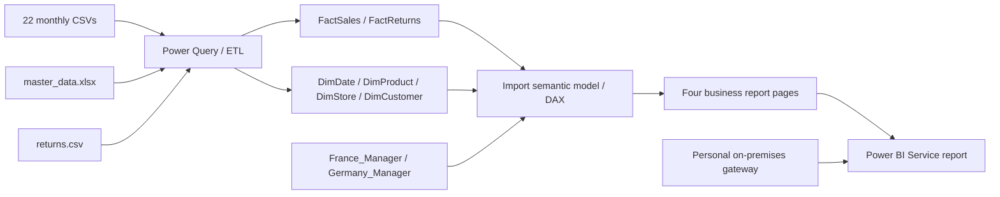
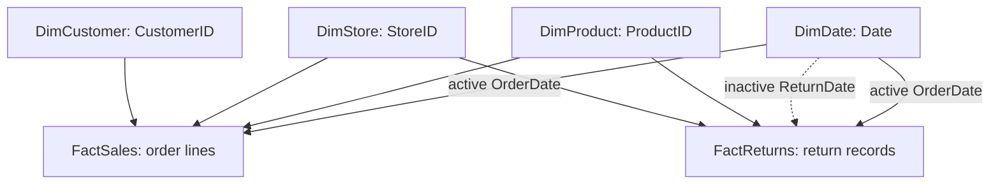

# RetailPulse — Solution architecture

## End-to-end flow

## Relationships (logical representation)

The diagram documents the implemented relationships discussed and tested during development. The complete tabular model metadata was not independently decoded from the PBIX binary in this delivery. Export a final Model view screenshot from Desktop to substantiate exact relationship cardinalities and directions.

## Key processing decisions

- Combine 22 monthly source files through Power Query's folder combine pattern and its Sample File helper queries.
- Remove five duplicated sales records by `LineID`: 21,105 raw records → 21,100 distinct lines.
- Preserve 22 sales lines with missing `UnitPriceEUR`; clean `N/A` to null rather than deleting the sale.
- Normalize market aliases and remove exact customer master duplicates.
- Align date intelligence comparisons to Jan–Oct 2025/2026. Date-role design distinguishes order cohorts from returns processed by actual return date.
- Use dimension-to-fact filtering and test country-level role filters at both sales and returns.

## Reporting vs deployment

A report is the visual presentation; a semantic model stores imported data, relationships and measures; Power BI Service hosts both. Desktop can read local files directly, whereas Service refresh of local file paths requires a working on-premises gateway (or correctly reconfigured cloud sources). A successful **manual refresh** was observed on Nov 16, 2026. There is no independent evidence yet of a scheduled run completing.

## Access and portfolio distribution

- RLS role definitions and **Test as role** have been exercised.
- Actual Viewer access to the deployed semantic model requires role assignments and appropriate permissions/licensing.
- A public portfolio should link to GitHub, screenshots or a video. Do not claim public interactive access without testing an actual shareable link and its visibility settings.
